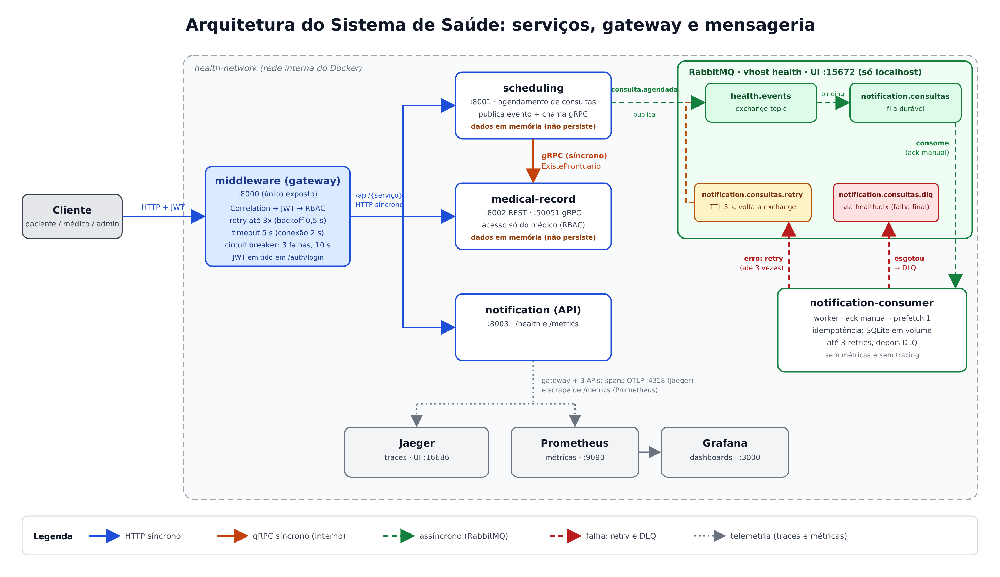
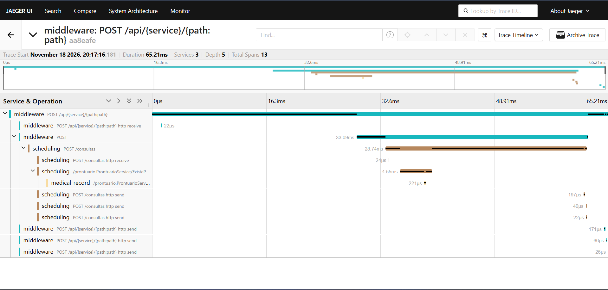

# Projeto-Arquitetura

## Arquitetura



##  Ports

> por enquanto eu já temos as seguitnes portas para os seguintes serviços/containers

> port 8000 para o middleware          
> port 8001 para o schedlling                         
> port 8002 para medical-record                                     
> port 8003 para notification                 


para o serviço de mensagemria to usando o rabbit
para acessar ele online http://localhost:15672
ele vai ser utilizado para a comunicação entre os serviços

pipeline de como rodar o tem ate o momento

da clone
abre a pasta Projeto_Arquetetura
dentro dela mesmo manda um

## Autenticação

O login é feito no gateway (`middleware`) e retorna um JWT com o usuário e o papel.

**Usuários de teste:**

| Usuário | Senha | Papel |
| --- | --- | --- |
| `paciente` | `paciente123` | `patient` |
| `medico` | `medico123` | `doctor` |
| `admin` | `admin123` | `admin` |

**Login (Linux/macOS/Git Bash):**

```bash
curl -X POST http://localhost:8000/auth/login \
  -H "Content-Type: application/json" \
  -d '{"username":"medico","password":"medico123"}'
```

**Login (PowerShell):**

```powershell
Invoke-RestMethod -Method Post -Uri http://localhost:8000/auth/login `
  -ContentType "application/json" `
  -Body '{"username":"medico","password":"medico123"}'
```

**Resposta:**

```json
{
  "access_token": "<jwt>",
  "token_type": "bearer",
  "expires_in": 1800
}
```

O token contém os campos `sub` (usuário), `role` (papel), `iat` e `exp`.
Credenciais inválidas retornam `401`. A documentação interativa fica em `http://localhost:8000/docs`.

### Validação do token no gateway

Todas as rotas exigem um JWT válido no header `Authorization: Bearer <token>`, exceto as rotas públicas abaixo. A lista é uma allowlist: uma rota nova nasce protegida por padrão.

| Rota pública | Motivo |
| --- | --- |
| `/health` | Healthcheck |
| `/metrics` | Scrape do Prometheus |
| `/auth/login` | Emissão do token |
| `/docs`, `/redoc`, `/openapi.json` | Documentação interativa (apenas desenvolvimento/demo) |

Requisições às demais rotas respondem `401` com o header `WWW-Authenticate: Bearer` nos casos:

| Situação | Mensagem |
| --- | --- |
| Header `Authorization` ausente ou fora do formato `Bearer <token>` | `Token de autenticação ausente` |
| Token expirado | `Token expirado` |
| Assinatura inválida, token malformado ou sem `sub`/`role` | `Token inválido` |

**Exemplo:**

```powershell
$r = Invoke-RestMethod -Method Post -Uri http://localhost:8000/auth/login `
  -ContentType "application/json" `
  -Body '{"username":"medico","password":"medico123"}'

Invoke-RestMethod http://localhost:8000/api/scheduling/health `
  -Headers @{ Authorization = "Bearer $($r.access_token)" }
```

### Identidade repassada aos serviços

Depois de validar o token, o gateway repassa a identidade aos serviços internos por headers:

| Header | Conteúdo |
| --- | --- |
| `X-User-Id` | Usuário (claim `sub`) |
| `X-User-Role` | Papel (claim `role`: `patient`, `doctor` ou `admin`) |

Qualquer header `X-User-*` enviado pelo cliente é descartado pelo gateway antes de repassar a requisição, para impedir que alguém forje a identidade. Os serviços internos confiam nesses headers porque só o gateway é alcançável de fora (os demais ficam na rede interna do Docker).

### Autorização por papéis (RBAC)

Depois de validar o token, o gateway confere se o papel do usuário (`role` do JWT) pode usar o método HTTP no serviço pedido. A tabela é uma allowlist: o que não está listado é **negado** (privilégio mínimo).

| Serviço (`/api/<serviço>/...`) | `patient` | `doctor` | `admin` |
| --- | --- | --- | --- |
| `scheduling` | GET, POST | todos os métodos | todos os métodos |
| `medical-record` | negado | todos os métodos | negado |
| `notification` | GET | GET | todos os métodos |

Métodos considerados: `GET`, `POST`, `PUT`, `PATCH`, `DELETE`.

**Decisões:**

- O `medical-record` é acessível **apenas por médico**. Por ser dado clínico sensível, nem o admin acessa (privilégio mínimo).
- Rotas fora de `/api/` (`/health`, `/auth/login`, docs) não passam pela tabela: são públicas ou protegidas apenas pelo JWT.
- A regra "paciente lê apenas o próprio prontuário" não foi implementada no gateway, pois exigiria que o serviço filtrasse os registros por `X-User-Id`. Fica como evolução.

**Respostas:**

| Situação | Código |
| --- | --- |
| Sem token, expirado ou inválido | `401` |
| Autenticado, mas papel sem permissão | `403` |

A tabela fica em `middleware/app/auth/permissions.py`; para mudar uma permissão basta editar esse dicionário.

## Observabilidade

Todos os serviços escrevem logs JSON (um por requisição, com `correlation_id`) e expõem métricas Prometheus em `GET /metrics`:

| Serviço | Métricas |
| --- | --- |
| middleware | `http://localhost:8000/metrics` |
| scheduling, medical-record, notification | Só na rede interna do Docker (`<serviço>:<porta>/metrics`) |

O `X-Correlation-ID` é gerado no gateway, repassado aos serviços e devolvido na resposta. O nível de log vem da variável `LOG_LEVEL` (padrão `INFO`).

Detalhes em [`docs/observabilidade.md`](docs/observabilidade.md).

## Comunicação interna via gRPC

O `scheduling` consulta o `medical-record` por gRPC para saber se o paciente possui prontuário (`ExisteProntuario`) ao criar uma consulta.

- **Contrato:** `proto/prontuario.proto` (única fonte da verdade).
- **Geração de código:** feita no build de cada container (`grpc_tools.protoc`), sem versionar os arquivos `*_pb2.py`.
- **Servidor:** `medical-record`, porta `50051`, apenas na rede interna do Docker (não publicada no host).
- **Cliente:** `scheduling`, endereço configurável por `MEDICAL_RECORD_GRPC_ADDR` (padrão `medical-record:50051`) e timeout por `GRPC_TIMEOUT_SECONDS` (padrão `2`).
- **Rastreabilidade:** o `X-Correlation-ID` viaja como metadata gRPC (`x-correlation-id`) e aparece nos logs JSON dos dois serviços.
- **Tolerância a falhas:** a chamada é informativa. Se o `medical-record` estiver fora do ar ou lento, o `scheduling` registra o aviso e segue com o agendamento.

## Tracing distribuído (Jaeger + OpenTelemetry)

Uma requisição que passa pelo gateway e chega aos serviços aparece no Jaeger como **um único trace**, com um span por serviço e por chamada interna.



*Criação de consulta: `middleware` → `scheduling` → `medical-record` (3 serviços, 13 spans).*

**Acesso:** `http://localhost:16686` (publicado só em `127.0.0.1`). O Jaeger recebe os spans por OTLP/HTTP na porta `4318`, apenas na rede interna do Docker. Os dados ficam em memória e somem ao reiniciar o container.

**Como funciona:**

- Cada serviço tem um `tracing.py` que configura o `TracerProvider` com `service.name` próprio e exporta os spans para `OTEL_EXPORTER_OTLP_ENDPOINT` (padrão `http://jaeger:4318`).
- **HTTP:** o gateway cria o trace, o `httpx` repassa o header W3C `traceparent` ao serviço de destino e o FastAPI do serviço continua o mesmo trace. Cada tentativa do retry do gateway vira um span de cliente separado.
- **gRPC:** o `scheduling` injeta o `traceparent` na metadata da chamada `ExisteProntuario` e o `medical-record` extrai e continua o trace.
- O tracing é o middleware mais externo do gateway, então respostas `401` e `403` também aparecem no trace. A ordem Correlation → JWT → RBAC não muda.
- `/health` e `/metrics` ficam fora dos traces, para o healthcheck e o scrape do Prometheus não poluírem o Jaeger.
- O `notification` expõe só a instrumentação HTTP. A propagação por RabbitMQ não foi implementada e fica como evolução.

**Como gerar um trace de exemplo (PowerShell):**

```powershell
$login = Invoke-RestMethod -Method Post -Uri http://localhost:8000/auth/login `
  -ContentType "application/json" `
  -Body '{"username":"medico","password":"medico123"}'
$h = @{ Authorization = "Bearer $($login.access_token)" }

# (opcional) cria um prontuário para o gRPC retornar existe=true
Invoke-RestMethod -Method Post -Uri http://localhost:8000/api/medical-record/v1/pacientes/p1/registros `
  -Headers $h -ContentType "application/json" `
  -Body '{"tipo":"consulta","descricao":"teste"}'

# cria a consulta: gera o trace middleware -> scheduling -> medical-record
Invoke-RestMethod -Method Post -Uri http://localhost:8000/api/scheduling/v1/consultas `
  -Headers $h -ContentType "application/json" `
  -Body '{"paciente_id":"p1","profissional_id":"m1","data_hora":"2027-01-10T10:00:00"}'
```

No Jaeger, escolha o serviço `middleware`, clique em **Find Traces** e abra o trace `POST /api/{service}/{path}` que mostra 3 serviços. A aba **System Architecture** desenha o grafo de dependências.

**Versões fixadas (lições aprendidas):**

| Pacote | Versão | Motivo |
| --- | --- | --- |
| `fastapi` | `0.115.6` | O `opentelemetry-instrumentation-fastapi` 0.48b0 quebra com FastAPI mais novo em rotas vindas de `include_router` (`AttributeError` em `/auth/*` e `/api/*`) |
| `setuptools` | `<81` | A instrumentação OTel ainda importa `pkg_resources`, que o `python:3.12-slim` não traz e o setuptools recente removeu |
| `grpcio`, `grpcio-tools` | `1.62.3` | O `opentelemetry-proto` 1.27 exige `protobuf<5`, e versões mais novas do gRPC pedem `protobuf>=5` |
| `opentelemetry-*` | `1.27.0` / `0.48b0` | Conjunto de versões testado em conjunto |

## Versionamento da API

As rotas de negócio são versionadas no caminho, **depois do nome do serviço**: `/api/<serviço>/<versão>/...`. O gateway repassa o caminho sem alterá-lo, então o RBAC vale igualmente para todas as versões. Rotas de infraestrutura (`/health`, `/metrics`) não são versionadas.

| Serviço | Versões | Observação |
| --- | --- | --- |
| `scheduling` | `v1`, `v2` | A `v2` muda o payload de criação de consulta |
| `medical-record` | `v1` | |

### scheduling: v1 e v2

`POST /api/scheduling/v1/consultas` e `POST /api/scheduling/v2/consultas` fazem a mesma operação (mesmas regras de conflito, evento no RabbitMQ e consulta gRPC). A única mudança é o nome do campo de data:

| Versão | Campo | Resposta |
| --- | --- | --- |
| `v1` | `data_hora` | `data_hora` |
| `v2` | `inicio` | `inicio` |

**v1**

```json
{"paciente_id": "paciente-001", "profissional_id": "medico-001", "data_hora": "2030-05-20T14:30:00Z"}
```

**v2**

```json
{"paciente_id": "paciente-001", "profissional_id": "medico-001", "inicio": "2030-05-20T14:30:00Z"}
```

A `v1` continua funcionando; uma versão inexistente (ex.: `v3`) responde `404`. O contrato de cada versão está em `docs/openapi-scheduling.json` (tags `Consultas` para a v1 e `Consultas v2` para a v2).

> Ao introduzir o `/v1`, as rotas sem versão (`/consultas`) deixaram de existir.

```
docker compose up --build -d
```

e basicamente ja vai estar rodando em segundo plano


deve aparecer algo nessa pegada no docker ps -a

```
❯ docker ps -a
CONTAINER ID   IMAGE                   COMMAND                  CREATED          STATUS                   PORTS                                                                                        NAMES
64e7aa55ad34   rabbitmq:3-management   "docker-entrypoint.s…"   21 minutes ago   Up 21 minutes            4369/tcp, 5671-5672/tcp, 15671/tcp, 15691-15692/tcp, 25672/tcp, 127.0.0.1:15672->15672/tcp   projeto-arquitetura-rabbitmq-1
7c3e0738d9e8   health-middleware       "uvicorn main:app --…"   21 minutes ago   Up 21 minutes            0.0.0.0:8000->8000/tcp, [::]:8000->8000/tcp                                                  projeto-arquitetura-middleware-1
fff5f4d8642c   health-medical-record   "uvicorn main:app --…"   21 minutes ago   Up 21 minutes            8002/tcp                                                                                     projeto-arquitetura-medical-record-1
db6463db0ce5   health-notification     "uvicorn main:app --…"   21 minutes ago   Up 21 minutes            8003/tcp                                                                                     projeto-arquitetura-notification-1
2a32b708bf19   health-scheduling       "uvicorn main:app --…"   21 minutes ago   Up 21 minutes            8001/tcp                                                                                     projeto-arquitetura-scheduling-1
```
