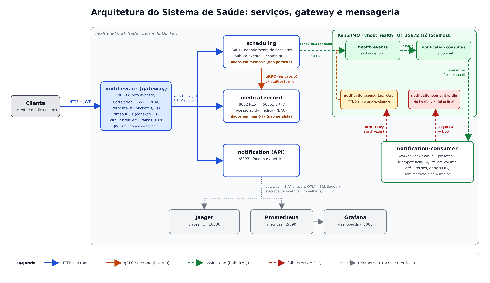
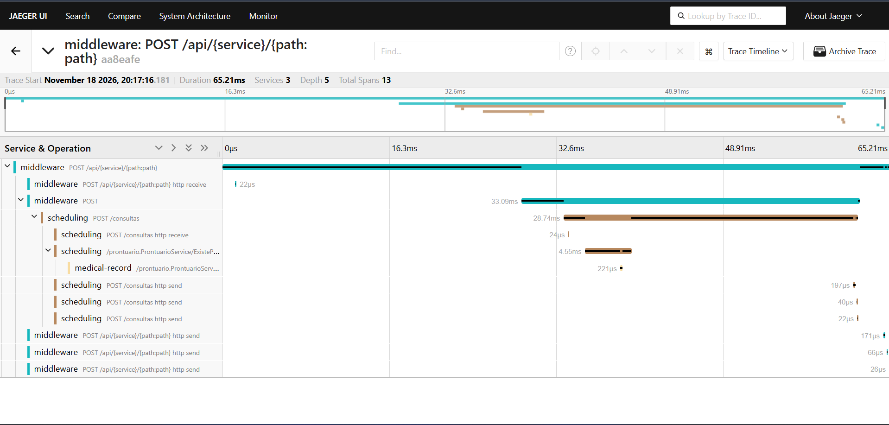

# Relatório Técnico: Middleware Distribuído para o Domínio de Saúde

Equipe: Arthur, Bento, Anna, Lucas e Lorenna.

## 1. Descrição da arquitetura

O sistema é um middleware distribuído para o domínio de saúde, em Python, executado com `docker compose`. O **gateway** (`middleware`) é implementado por nós, sem middleware pronto, e é o único componente exposto ao host.

| Componente | Papel |
| --- | --- |
| `middleware` (8000) | Gateway: roteamento, JWT, RBAC, correlation ID, timeout, retry, circuit breaker |
| `scheduling` (8001) | Agendamento de consultas; produtor de eventos; cliente gRPC |
| `medical-record` (8002) | Prontuário; servidor gRPC |
| `notification` (8003) | API de notificações e consumidor de eventos |
| `rabbitmq` | Broker de mensagens |
| `jaeger`, `prometheus`, `grafana` | Tracing, métricas e painéis |

**Fluxo síncrono:** cliente → gateway (valida JWT e papel) → serviço (REST).
**Fluxo assíncrono:** `scheduling` publica `consulta.agendada` → RabbitMQ → `notification` consome.
**Chamada interna:** `scheduling` → `medical-record` por gRPC, para consultar se o paciente tem prontuário.

Os serviços só se comunicam pela rede, nunca por import direto. Cada serviço tem seu próprio repositório de dados em memória.

## 2. Decisões técnicas e justificativas

### 2.1 Segurança (JWT e RBAC)

**Autenticação.** `POST /auth/login` valida usuários de teste (paciente, médico e admin) e emite um JWT (HS256) com `sub`, `role`, `iat` e `exp` (30 min). O segredo vem do `.env`, e o gateway **falha ao subir** se ele não existir, em vez de rodar com um valor padrão. A decodificação fixa `algorithms=[...]`, o que impede o ataque de troca de algoritmo no header do token.

**Validação no gateway.** Um middleware valida o token em toda requisição, exceto numa **allowlist** de rotas públicas (`/health`, `/metrics`, `/auth/login` e a documentação). Uma rota nova nasce protegida por padrão. Respostas `401` (sem token, expirado ou inválido) saem com `WWW-Authenticate: Bearer`.

**Autorização (RBAC).** Uma tabela serviço × papel × método define o que cada papel pode fazer; o que não está listado é **negado** (privilégio mínimo). Resposta `403` para papel sem permissão.

| Serviço | `patient` | `doctor` | `admin` |
| --- | --- | --- | --- |
| `scheduling` | GET, POST | todos | todos |
| `medical-record` | negado | todos | negado |
| `notification` | GET | GET | todos |

**Identidade para os serviços.** Após validar o token, o gateway repassa `X-User-Id` e `X-User-Role`. Como o proxy copia os headers do cliente, **todo `X-User-*` vindo de fora é descartado antes** de injetar os valores do token, o que impede a falsificação de identidade.

**Ordem dos middlewares.** Tracing → Correlation ID → JWT → RBAC. Assim, `401` e `403` também saem com `X-Correlation-ID` e aparecem no trace.

**Justificativas e trade-offs**

- `medical-record` só para médico: dado clínico sensível. Nem o admin acessa.
- `401` ("não sei quem é você") e `403` ("sei quem é, mas não pode") são distinguidos, e a mensagem de login inválido é a mesma para usuário inexistente e senha errada.
- Os serviços internos confiam nos headers `X-User-*` porque só o gateway é alcançável de fora.

**Limitações assumidas**

- Usuários em memória e hash SHA-256 sem salt: adequado só para teste; em produção, banco com bcrypt/argon2.
- Sem renovação (refresh) nem revogação de token.
- A chamada gRPC interna não passa pelo gateway, então JWT e RBAC não se aplicam; em produção, usar mTLS.
- Regra "paciente lê o próprio prontuário" não implementada (exigiria filtro por `X-User-Id` no serviço).
- Rotas de documentação públicas por conveniência de demo.

### 2.2 Gateway e resiliência

O gateway repassa `/api/<serviço>/<versão>/...` com **timeout** de 5 s por tentativa (2 s de conexão), **retry com backoff exponencial** (3 retries; 0,5 s, 1 s e 2 s) e **circuit breaker por serviço** (abre após 3 requisições que esgotaram os retries; após 10 s entra em *half-open*; um sucesso fecha, uma falha reabre). Só falhas de rede contam; respostas 4xx/5xx do serviço são repassadas.

| Situação | Resposta |
| --- | --- |
| Serviço parado (timeouts em todas as tentativas) | `504` após ~11,6 s |
| Breaker aberto | `503` imediato, com `Retry-After: 10` |
| Serviço inexistente | `404` |

Medimos esses valores derrubando o `scheduling`: três chamadas com 504 e as seguintes com 503 instantâneo. O breaker por serviço evita que a queda de um componente afete os outros. **Limitação:** o retry também se aplica a `POST` sem chave de idempotência.

### 2.3 Mensageria e consistência

**Consistência eventual entre serviços e forte dentro de cada serviço.** O `scheduling` grava a consulta e publica `consulta.agendada` no RabbitMQ; o `notification` consome depois. Priorizamos disponibilidade: o agendamento não depende de o `notification` estar no ar.

A entrega é *at-least-once*: filas duráveis, mensagens persistentes, confirmação de publicação e `ack` manual. Falhas de processamento passam por uma fila de retry (TTL de 5 s, até 3 vezes) e depois seguem para a **DLQ**. A **idempotência** usa o `message_id` registrado em SQLite (volume persistente). Produtor e consumidor reconectam automaticamente se o broker cair.

**Limitações encontradas nos testes:** com o broker fora, o produtor tenta em loop dentro da requisição, então o cliente pode receber `409` ou `504` mesmo com a consulta criada; o `message_id` é registrado antes do "envio", o que pode perder uma notificação se o consumidor cair entre os dois passos. Evolução: *transactional outbox*.

### 2.4 Serviços de negócio e contratos

`scheduling` (criar, listar, consultar e cancelar consultas, com regra de conflito de horário por profissional) e `medical-record` (registros de prontuário por paciente, filtráveis por tipo). Os dados ficam em memória. Os contratos são documentados em OpenAPI (`/docs` e arquivos exportados no repositório), com modelos de erro padronizados (`404`, `409`, `422`) e testes automatizados em cada serviço.

### 2.5 Observabilidade e tracing

**Logs:** JSON, um por requisição, com `correlation_id`, método, rota, status e duração. **Métricas:** `GET /metrics` em cada serviço (contagem, latência e erros 5xx por rota-modelo), coletadas pelo **Prometheus** e exibidas no **Grafana**. **Correlation ID:** gerado no gateway, repassado por HTTP e gRPC, devolvido no header e presente nos logs do gateway, do serviço e do consumidor (validado ponta a ponta).

**Tracing:** OpenTelemetry com exportação OTLP/HTTP para o **Jaeger**. Uma criação de consulta aparece como **um único trace** passando por `middleware`, `scheduling` e `medical-record` (13 spans), com o header W3C `traceparent` repassado pelo `httpx` e pela metadata gRPC. O tracing é o middleware mais externo, então `401` e `403` também aparecem no trace. A propagação pelo RabbitMQ não foi implementada.

### 2.6 Comunicação interna via gRPC

O `scheduling` consulta o `medical-record` por gRPC (`ExisteProntuario`) ao criar uma consulta. **Por que gRPC neste ponto:** é uma chamada interna, síncrona e frequente entre dois serviços que se conhecem; o contrato tipado em `proto/prontuario.proto` é a única fonte da verdade (o código é gerado no build, sem versionar os `*_pb2.py`); a serialização binária sobre HTTP/2 reduz o custo frente a JSON; e há suporte nativo a *timeout* e *metadata* (usada para o correlation ID e o `traceparent`). Mantivemos REST na borda, onde legibilidade e compatibilidade importam mais.

A chamada é **informativa**: tem timeout de 2 s e, se falhar, o agendamento continua (testado com o `medical-record` parado). Como não passa pelo gateway, JWT e RBAC não se aplicam; em produção, usaríamos mTLS.

### 2.7 Versionamento de API

A versão fica no caminho, **depois do serviço**: `/api/scheduling/v1/consultas` e `/api/scheduling/v2/consultas`. Assim o gateway repassa o caminho sem alteração e o RBAC (que lê apenas o serviço) vale para todas as versões. A `v2` muda um campo do payload (`data_hora` passa a se chamar `inicio`), reaproveita o mesmo fluxo da `v1` e convive com ela. O `medical-record` já usava `/v1`. Uma versão inexistente responde `404`. O contrato OpenAPI documenta as duas versões. **Custo:** as rotas sem versão deixaram de existir.

### 2.8 Infraestrutura

Todo o sistema sobe com `docker compose up --build`. A configuração é externalizada em `.env` (segredos fora do Git; `.env.example` versionado), há *healthchecks* nos serviços e os serviços de negócio ficam só na rede interna do Docker (apenas o gateway é exposto). Para o gRPC, o contexto de build passou à raiz, com `.dockerignore` para não enviar o `.env` ao build. Um roteiro (`scripts/e2e.ps1`) executa o fluxo completo e valida 17 passos: login, agendamento, evento na fila, notificação consumida, prontuário, `401`/`403` e rastreio do correlation ID nos quatro containers.

## 3. Dificuldades e lições aprendidas

| Dificuldade | Lição |
| --- | --- |
| O proxy copiava todos os headers do cliente, abrindo espaço para forjar `X-User-Role` | Descartar o que vem de fora antes de injetar identidade |
| A ordem dos middlewares do Starlette (o último adicionado é o mais externo) determinava se `401` e `403` saíam com correlation ID | Documentar a ordem e testar com `curl -i` |
| O consumidor e o produtor do RabbitMQ em loop de reconexão: o produtor bloqueia a requisição quando o broker cai (cliente recebe `409` ou `504` com a consulta criada) | Testar cada queda; o próximo passo seria *transactional outbox* |
| O gateway repete `POST` sem idempotência | Idempotência precisa ser pensada junto com o retry |
| Conflitos de versões no tracing (`fastapi 0.115.6`, `setuptools<81`, `grpcio 1.62.3` por causa do `protobuf<5`) | Fixar versões testadas em conjunto |
| O contexto de build do Docker não enxergava o `proto/` na raiz | Mover o contexto para a raiz e usar `.dockerignore` para não copiar `.env` |
| Código gerado do protobuf não deve ir para o Git | Gerar no build e ignorar `*_pb2*.py` |
| Healthcheck `unhealthy` por rota `/health` perdida em um merge | O roteiro ponta a ponta achou o problema; testar após cada merge |
| Merges e conflitos em `requirements.txt` e `docker-compose.yml` entre PRs paralelos | Branches curtas, PRs pequenos e ordem de merge combinada |

## 4. Uso de IA/LLM

O grupo usou IA/LLM como apoio. A responsabilidade técnica é do grupo: tudo foi revisado, executado e validado por quem o usou. O registro detalhado, com os prompts principais, está no arquivo `docs/uso-ia.md` do repositório.

| Integrante | Ferramenta/modelo | Onde usou | Como validou |
| --- | --- | --- | --- |
| Bento | Claude | Divisão de tarefas e issues; login/JWT, validação no gateway e RBAC; documento de tolerância a falhas; bônus de gRPC, tracing, versionamento; roteiro e script ponta a ponta; relatório | Testou cada commit (login, 401/403, fila, logs, trace, `pytest`), corrigiu quando a execução real divergiu do previsto |
| Anna | Claude | Gateway: roteamento, correlation ID, timeout, retry, circuit breaker e teste de falha ao vivo | Testou com `curl`: 504 em ~11,6 s, 503 imediato com breaker aberto, recuperação após 10 s |
| Arthur | [CONFIRMAR: ferramenta] | Prometheus e Grafana (observabilidade) | Testou rodando localmente o Grafana e o Prometheus |
| Lucas | [CONFIRMAR: ferramenta] | Mensageria: produtor (#12), consumidor (#13), retry, DLQ e idempotência (#14) e reconexão do RabbitMQ (#27) | Testou com um relatório gigante de testes |
| Lorenna | Claude | API REST do scheduling (#9) e do medical-record (#10), com contratos OpenAPI; logs JSON e métricas nos serviços (#11) | Rodou os testes conferindo o /docs e /metrics |

**Exemplos de prompts:** "dividir as tarefas entre 5 integrantes em issues e branches" (organização); "explicar por onde começar a issue de JWT e separar em commits pequenos" (segurança); "passo a passo de roteamento, retry com backoff e circuit breaker" (gateway); envio de logs, erros de Docker/Git e saídas de teste para diagnóstico.

**Pontos de atenção que a IA não resolveu sozinha:** valores previstos que a medição real contrariou (por exemplo, o 504 de ~11,6 s em vez de um 503 rápido) e problemas de ambiente (Docker, versões de pacotes, conflitos de merge), resolvidos por nós.